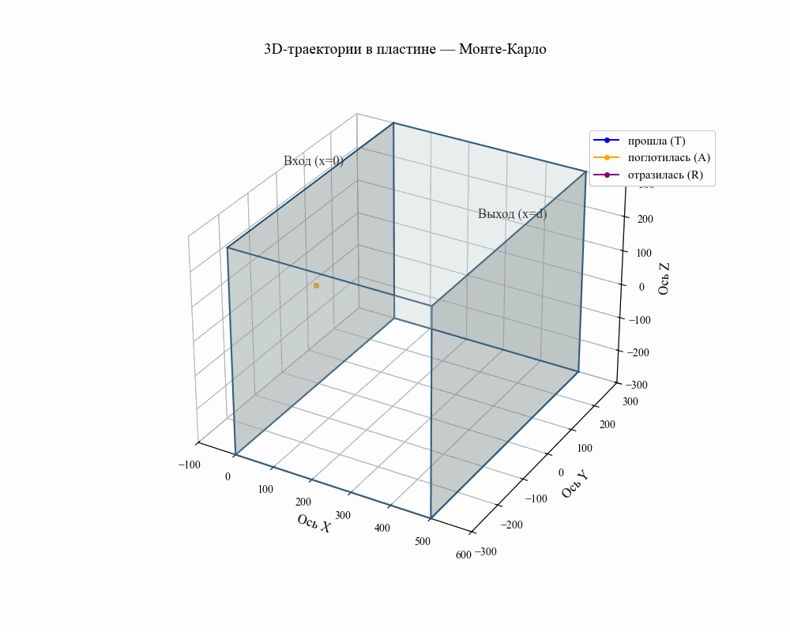

# Лабораторная работа № 3
## Стохастическое моделирование. Метод Монте-Карло

Моделирование переноса частиц через плоскую пластину вещества методом Монте-Карло.

### Постановка задачи

Рассматривается бесконечная в направлениях y, z пластина вещества толщиной d. Слева в неё влетает поток частиц. В веществе реализуются два канала взаимодействия:

- поглощение с линейным коэффициентом $\sigma_{abs}$;
- изотропное рассеяние с линейным коэффициентом $\sigma_{streu}$.

Требуется найти вероятности трёх исходов:

- $p_R$ — отражение (частица вылетела через x < 0);
- $p_A$ — поглощение (частица прекратила существование внутри пластины);
- $p_T$ — прохождение (частица вылетела через x > d).

### Метод

Реализовано аналоговое моделирование Монте-Карло. Каждая частица прослеживается от входа в пластину до момента выхода за границу или поглощения. На каждом шаге разыгрываются:

Оценки вероятностей определяются как относительные частоты исходов в выборке из N независимых расчетов.

